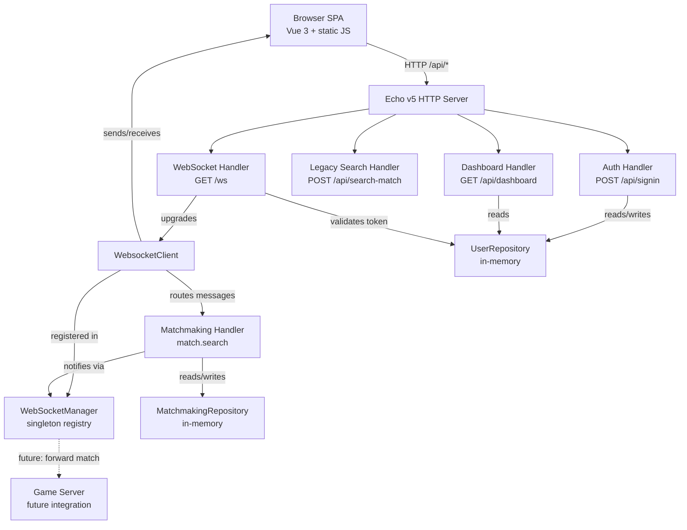

# Web Game Server — Web Service

## Description

The `web` service is the main HTTP and WebSocket entry point for the Web Game Server platform. It serves the browser-based SPA, handles user authentication, manages matchmaking lobbies, and keeps authenticated clients connected through a persistent WebSocket connection.

When a player signs in, the service issues a token and opens a WebSocket channel. Players can then search for a match; the service fills lobbies and notifies all matched players in real time over the same WebSocket channel. Once a match is ready, the next step is to hand the players off to the dedicated Game Server.

## Technology

| Layer | Technology |
|-------|------------|
| Language | Go 1.25 |
| Web Framework | [Echo v5](https://github.com/labstack/echo/v5) |
| WebSocket Library | [coder/websocket](https://github.com/coder/websocket) |
| Frontend | Plain HTML/CSS/JS + Vue 3 (loaded from CDN) |
| Testing | `github.com/stretchr/testify` |

## High Level Architecture



## Getting Started

### Run the server

```sh
cd web
go run ./cmd/web.go
```

Or from the repository root:

```sh
make web
```

The server listens on `0.0.0.0:8000`.

### Database

By default the server creates `web.db` in the working directory. Set `WEB_DB_DSN` to override (use `:memory:` for an ephemeral database):

```sh
WEB_DB_DSN=:memory: go run ./cmd/web.go
```

### Run tests

```sh
cd web
go test ./...
```

## Main HTTP Endpoints

| Method | Path | Auth | Description |
|--------|------|------|-------------|
| POST | `/api/signin` | No | Create or fetch a user; returns a token |
| GET | `/api/healthcheck` | No | Health check |
| GET | `/api/dashboard` | Yes | Return user info (points, matches) |
| POST | `/api/search-match` | Yes | Legacy HTTP matchmaking (requires SSE; currently unused by the SPA) |
| GET | `/ws` | Token (first message) | Upgrade to WebSocket |

## WebSocket Message Flow

1. Client connects to `ws://localhost:8000/ws`.
2. Server waits up to **10 seconds** for the auth message: `{"token":"..."}`.
3. Server validates the token against the SQLite user repository.
4. On success, the client is registered and receives:
   ```json
   {"type":"connected","socketId":"<uuid>"}
   ```
5. Server starts `ReceiveRoutine` and `PingRoutine`.
6. Client sends `{"type":"match.search","game":"TIC-TAC-TOE"}`.
   - If the lobby is not full, the server replies with `{"type":"match.search.waiting"}`.
   - When the lobby is full, every player receives `{"type":"match","game":"...","total_players":2,"players":["..."]}`.

## Project Structure

```
web/
├── cmd/web.go                          # Application entry point
├── internal/
│   ├── server/
│   │   ├── web.go                      # Echo setup, routes, static files
│   │   ├── routes.go                   # HTTP route handlers
│   │   └── websocket/
│   │       ├── websocket.go            # /ws upgrade handler
│   │       ├── websocket_client.go     # Single connection abstraction
│   │       ├── websocket_manager.go    # Singleton client registry / groups
│   │       ├── matchmaking_handler.go  # WebSocket match-search handler
│   │       └── *_test.go               # Unit tests
│   ├── business/websocket/             # Message parser
│   ├── db/                             # SQLite repositories + DB init
│   ├── middleware/                     # Auth + disabled SSE middleware
│   ├── http_helper/                    # JSON error helpers
│   ├── models/                         # Domain models + context keys
│   ├── helpers/                        # Random token helper
│   └── lang/                           # Error/message constants
├── public/                             # SPA assets
│   ├── index.html
│   └── static/
│       ├── main.js
│       └── styles.css
├── go.mod / go.sum
├── CONTEXT.md                          # Detailed project context
├── TODO.md                             # Task list
└── README.md                           # This file
```

## Current Limitations & Next Steps

- **SQLite persistence is implemented.** `USER`, `USER_SESSION`, `USER_POINTS`, `MATCH`, `USER_MATCH`, and `GAME` tables are created; `USER` and `MATCH` tables are actively used.
- **SSE match-notification is disabled.** The SPA now uses WebSocket matchmaking.
- **Game Server integration is pending.** Full matches are notified over WebSocket but not yet forwarded to the Game Server.
- See `TODO.md` for the full task list.
